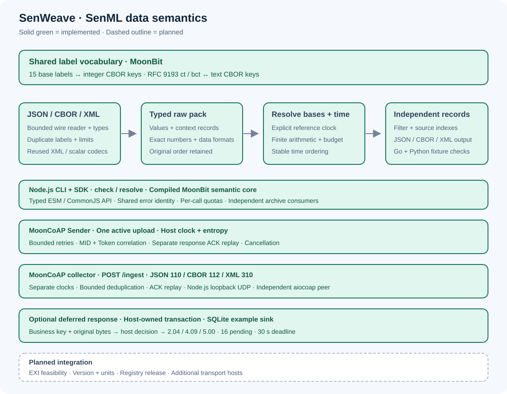

<p align="center"></p>

# SenWeave · 感织

面向 MoonBit 物联网应用的 SenML 测量数据语义与 JSON／CBOR 交换库。

**当前阶段：SenML JSON 解析、基字段展开与独立记录输出，版本 `0.1.0-dev.3`。** 提供带资源上限的解析与展开、类型化记录、四种测量值和结构化错误。CBOR 编解码和网络集成仍在开发；尚未发布到 Mooncakes。

SenML 数据包里的测量记录可以继承此前出现的设备名称、基准时间、单位和基准数值。记录从原数据包取出前，需要先应用这些信息，才能安全地独立保存或筛选。项目依据 [RFC 8428](https://www.rfc-editor.org/rfc/rfc8428.html)，为设备网关、采集服务和离线工具提供这层共享能力。

## 从源码运行

安装 [MoonBit 官方工具链](https://www.moonbitlang.com/download/)，JS 与 wasm-gc 目标需要可用的 JavaScript 运行时，native 目标需要平台 C 工具链。

当前代码使用 `Int32` 命名，开发验证工具链为 `moon 0.1.20261023`、`moonc v0.10.17+d971670cd`。请使用这一版或更新的兼容工具链；CI 使用官方 latest 通道，并在日志中记录实际版本。

```sh
moon check --target js --deny-warn
moon test --target js
moon run examples/labels --target js
moon run examples/json --target js
moon run examples/gateway --target js
```

`examples/labels` 展示标准标签映射。`examples/json` 解析包含基准设置、数值、布尔与二进制值的数据包，输出 `raw records: 4, measurements: 3`，保留 `22.50` 的数字原文，并演示拒绝未知强制扩展。

`examples/gateway` 把 4 条原始记录展开为测量，筛选并按时间输出 2 条温度记录，分别为 `23` 和 `22.5`，随后逐条独立重读。调用方提供接收时刻，核心库不读取系统时钟。

CI 针对 Windows、Linux 和 `native`、`js`、`wasm-gc` 三个后端运行相同测试与示例。

## 已有接口

- `parse_json(input, limits?)`：返回 `Pack`，失败抛出带诊断的 `SenmlError`。
- `Pack::len()`、`record(index)`、`measurement_count()`：读取原始记录和测量数量；越界索引返回 `None`。
- `Pack::resolve(reference_time?, max_expanded_code_units?)`：应用名称、单位、时间、数值与和的基字段，返回按时间排序的 `ResolvedPack`；相对时间需要显式参考时刻。
- `ResolvedPack::filter(predicate)`、`record(index)`、`len()`：筛选和读取独立测量；等时记录保留输入顺序，`source_index` 指向原始记录。
- `ResolvedPack::to_json_string()`、`ResolvedRecord::to_json_string()`：输出完整数据包或单条测量组成的数组，可独立保存和转发。
- `MeasurementValue`：区分数值、文本、布尔和二进制值；零、`false`、空文本和空二进制会保留。
- `Number::json_literal()`：读取原始数字文本；`as_double()` 提供可能舍入的 binary64 近似值。
- `SenmlError::diagnostic()`：读取错误类别、记录索引、字段及可用的 JSON 行列位置。
- `ParseLimits::default()`：提供输入大小、记录数、嵌套深度、字段数和字符串／数字长度上限。
- `Label::from_json_name(name)`：识别区分大小写的标准 JSON 标签。
- `Label::from_cbor_key(key)`：识别标准整数 CBOR 标签。
- `Label::json_name()` 与 `Label::cbor_key()`：获取同一标签的两种表示。

标签查找对未知名称返回 `None`。JSON 解析器按 RFC 8428 忽略普通未知扩展，拒绝名称以 `_` 结尾的未知扩展。解析支持版本 10，并拒绝重复的解码后成员名称。详细边界与默认上限见 [JSON 输入约定](docs/json-profile.md)。

**`parse_json` 返回原始记录；独立取出或筛选测量前，应先调用 `resolve`。** 展开会保留原包，消除基字段并生成绝对时间；仅有基字段的上下文记录不输出。普通未知扩展会被丢弃，输出不保留扩展。

展开算术采用 binary64，可能舍入；没有加法或加零时保留数值原文。溢出、缺失相对时钟和不可表示的绝对时间会失败，展开体积默认采用 4 Mi UTF-16 单元的保守上限。使用示例、时间与数值边界见 [展开和输出约定](docs/resolution.md)。

## 下一步实现

1. 评估并复用现有 CBOR 包，验证整数键、二进制值和数值边界，完成 JSON／CBOR 转换。
2. 对照更多 RFC 示例与外部 SenML 实现验证语义，补充离线检查工具与真实传输集成。
3. 正式发布 Mooncakes 包，在独立消费项目中验证注册表安装与使用。

首版范围为 RFC 8428 的 SenML JSON／CBOR 数据包。XML、EXI、SenSML 无限流和单位换算不在首版范围内。

## 架构与生态



核心以 MoonBit 实现，接口接收内存数据。文件、时钟、网络和界面由消费项目提供。现有 [CBOR](https://mooncakes.io/docs/2515050242/cbor)、[MQTT](https://mooncakes.io/docs/Strangelight-Merser/moon-mqtt-client) 和 [CoAP](https://mooncakes.io/docs/sujy123456/mooncoap) 包是拟集成的上下游；当前尚无第三方运行时依赖或已完成的集成。

检索记录与实现决策见 [开发记录](docs/development.md)。

## 许可

[Apache-2.0](LICENSE)。标准行为以 RFC 8428 为准；互操作验证计划参考 [absmach/senml](https://github.com/absmach/senml) 和 [KPN Python SenML](https://github.com/kpn-iot/senml-python-library)。当前实现未复制这些项目的源代码。
