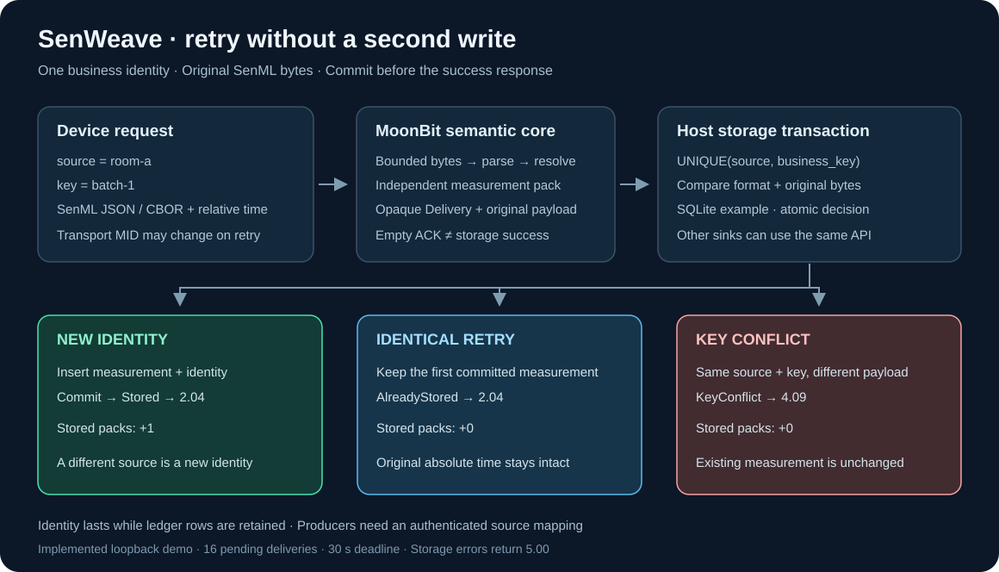

# SenWeave · 感织

## 面向 MoonBit 物联网应用的 SenML 测量数据语义与 JSON／CBOR 交换库

**项目申报书**

| 项目 | 内容 |
| --- | --- |
| 申报人 | 王正 |
| 项目方向 | MoonBit 开源生态、物联网数据处理与工程基础库 |
| 当前版本 | `0.1.0-dev.12` |
| 实现语言 | MoonBit；Node.js 承担 SDK、文件与 UDP 示例宿主 |
| 开源许可 | Apache-2.0 |
| 公开仓库 | [q0w1ertyuiop/SenWeave](https://github.com/q0w1ertyuiop/SenWeave) |
| 材料日期 | 2026 年 10 月 27 日 |

## 一、项目摘要

SenWeave 面向设备网关、采集服务和离线数据工具，提供可复用的 SenML 测量数据处理能力。SenML 记录可以继承原数据包中先前出现的设备名称、单位、时间及基准数值。应用若直接拆分、筛选或存储记录，容易丢失这些上下文；设备重试带有相对时间的原始包时，也可能因接收时刻变化而产生不同的测量时间。

项目依据 RFC 8428，以 MoonBit 实现带资源上限的 JSON／CBOR 解析、字段校验、基字段展开和独立测量输出。核心库接收内存数据，由调用方提供参考时刻；CoAP 子包提供发送、接收和延迟完成接口，宿主可在自己的存储事务提交后报告结果。应用业务键配合原始负载与格式，可识别采集进程重启后的原样重试，并拒绝同键换负载。

目前已形成 MoonBit 公共库、支持 ESM／CommonJS 的 Node.js SDK、离线 CLI、CoAP 收发适配器及 SQLite 宿主示例。核心与协议逻辑通过 native、JS、wasm-gc 三个后端验证，分发归档已在独立消费项目中运行。后续重点是完成 Mooncakes／npm 正式发布、增加真实设备输入与外部实现对照，使应用能够直接安装和复用。

**关键词：** MoonBit；SenML；物联网；数据语义；CBOR；CoAP；业务幂等。

## 二、需求背景与目标用户

### 2.1 测量记录离开原数据包后仍需保留含义

物联网采集流程经常需要从一个数据包中取出某类测量，分别写入数据库、按时间排序，或转换编码后转发。SenML 为减少重复字段，允许记录共享基准设置。[RFC 8428 §4.6](https://www.rfc-editor.org/rfc/rfc8428.html#section-4.6) 要求记录离开原包使用前先完成展开。

例如，设备发送：

```json
[
  {"bn":"sensor:","bu":"Cel","bv":20},
  {"n":"temperature","v":2.5,"t":-3}
]
```

在参考接收时刻为 `1793000000` 秒时，独立测量应包含完整名称 `sensor:temperature`、单位 `Cel`、数值 `22.5` 和绝对时刻 `1792999997`。只保存第二个对象，会失去名称前缀、单位与数值基准，时间也仍依赖原通信上下文。

通用 JSON／CBOR 编解码只能恢复数据结构。应用还需要处理基字段继承、相对时间、版本、值类型及扩展规则。将这部分逻辑集中为共享库，可以减少不同网关和工具之间的重复实现与行为偏差。

### 2.2 成功应答与业务提交需要衔接

设备收到网络应答后，通常会决定是否重试。若采集器在数据提交前返回业务成功，进程中断可能造成设备停止重试而数据尚未保存。若数据已经提交、响应却丢失，设备重发又可能产生重复记录。CoAP 的交换去重有明确生存期，进程重启后的业务身份需要应用另行保存。

SenWeave 将解析通过、存储完成和重复提交作为不同状态暴露给宿主。对带相对时间的原样重试，示例账本保留首次展开结果，避免把网络重试解释为一次新的测量。

### 2.3 主要用户与使用方式

| 目标用户 | 典型需求 | 可复用成果 |
| --- | --- | --- |
| MoonBit 网关开发者 | 校验设备数据、展开上下文、筛选并转发测量 | 根包的解析、展开和序列化接口 |
| 采集服务开发者 | 在业务提交后应答，处理重试、冲突和失败 | CoAP 子包及宿主完成接口 |
| Node.js 应用开发者 | 在现有 ESM／CommonJS 项目中接入 SenML | 含编译核心的 SDK 与 TypeScript 声明 |
| 设备联调与数据维护人员 | 检查 JSON／CBOR 文件、转换为独立记录 | `check`／`resolve` 离线 CLI |

上述场景是项目面向的接入需求，现有运行证据来自自动化测试和回环 UDP 示例；真实设备部署仍需后续验证。

## 三、生态调研与项目独立贡献

### 3.1 Mooncakes 检索结果

2026 年 10 月 27 日复核了 [Mooncakes 官方模块元数据](https://mooncakes.io/api/v0/modules)的 3,355 条记录，并通过官方搜索接口检索 [SenML](https://mooncakes.io/api/v0/search?kw=senml)、[SenSML](https://mooncakes.io/api/v0/search?kw=SenSML) 和 [RFC 8428](https://mooncakes.io/api/v0/search?kw=RFC%208428)。模块元数据中未发现这些名称的字面匹配；SenML 搜索返回的 4 个模块经检查为无关的近似词匹配，另外两项返回为空。

在这一检索范围内，未找到明确标注提供 SenML 基字段展开与独立测量输出的已发布模块。该结果描述已检索的公开资料；选题价值同时由标准需求、公开接口和实际验证支撑。

### 3.2 与现有项目的分工

| 现有项目 | 已有能力与本项目的关系 | SenWeave 的具体增量 |
| --- | --- | --- |
| [2515050242/cbor@0.1.2](https://mooncakes.io/docs/2515050242/cbor@0.1.2) | 通用 CBOR 编解码及相关处理；项目已固定版本复用 | SenML 整数标签、值类型、基字段语义和独立测量输出；进入依赖前的字节预检 |
| [sujy123456/mooncoap@0.1.1](https://mooncakes.io/docs/sujy123456/mooncoap@0.1.1) | CoAP 报文、交换、重传与重复响应处理；项目已复用其内存协议核心 | SenML 接入策略、测量展开、存储后应答及业务身份与宿主事务的衔接 |
| MoonBit 标准库 JSON 能力 | JSON 语法与数字文本等基础处理；项目已复用 | SenML 上下文记录、字段约束、版本与扩展检查，以及跨记录展开 |
| [KPN Python SenML 1.0.1](https://pypi.org/project/kpn-senml/1.0.1/) | 外部语言实现，作为固定版本互操作对照 | 为 MoonBit 应用提供直接调用的接口，并记录指定场景的交换结果与版本差异 |

项目的独立贡献集中在 **SenML 测量语义、受控的数据展开和应用提交衔接**。CBOR 编码和 CoAP 协议状态机由已有生态能力承担。新增实现及测试位于公开仓库，可按接口和测试脚本逐项核对。

## 四、建设目标与成果范围

项目目标是使 MoonBit 应用能够在明确的资源和数值约定下，将 SenML 原始数据包转换为可独立存储、筛选和转发的测量，并提供可替换宿主的接入方式。

| 成果 | 当前状态 | 接入边界 |
| --- | --- | --- |
| MoonBit SenML 公共库 | 已实现 | JSON／CBOR 解析、校验、展开、筛选与独立输出；核心无文件、网络和时钟 I/O |
| CoAP 发送与接收子包 | 已实现 | 接收内存报文并产生事件；宿主负责套接字、时钟和存储 |
| Node.js SDK | 已实现并验证本地分发 | Node.js 24 及以上；ESM／CommonJS 共用实现，提供 TypeScript 声明 |
| 离线 CLI | 已实现 | 检查与转换文件／标准输入；输出文件拒绝覆盖已有目标 |
| UDP／SQLite 示例 | 已实现并运行 | 回环 UDP、存储后应答、重启重试、来源隔离与负载冲突 |
| 注册表安装 | 待完成 | Mooncakes 与 npm 正式发布及发布后独立安装验证 |
| 更多宿主与现场输入 | 待开展 | MQTT、native UDP 宿主、真实设备接入及持续运行评估 |

首版范围为 RFC 8428 的有限 SenML JSON／CBOR 包。XML、EXI、SenSML 无限流、单位换算和任意精度十进制运算留在当前范围之外。

## 五、技术路线与模块设计

### 5.1 同一语义核心服务不同入口


数据处理主线为：**JSON／CBOR 输入 → 字段与资源检查 → 原始 `Pack` → 基字段和时间展开 → `ResolvedPack` → 筛选与独立输出**。

JSON 与 CBOR 使用同一套标签和记录模型。原始包保留上下文顺序，展开时应用名称、单位、时间、基值与基和，随后按时间排序；相同时刻保留原输入次序。参考时刻由调用方提供，缺少必要参考时刻时返回明确错误。

MoonBit 核心和协议状态机已在 native、JS、wasm-gc 验证。当前文件与实际 UDP 宿主由 Node.js 提供，native UDP 宿主尚未接入。这样的接口划分允许消费项目自行选择文件系统、数据库或消息队列。

### 5.2 可直接复用的公共接口

| 接口 | 作用 |
| --- | --- |
| `parse_json`／`parse_cbor`／`parse_payload` | 将文本或传输字节读入原始包，报告结构、字段和资源错误 |
| `Pack::resolve` | 应用基字段与参考时刻，生成独立测量 |
| `ResolvedPack::filter` | 在完整展开后按应用谓词筛选，保留时间顺序 |
| `to_json_string`／`to_cbor_bytes` | 输出包或单条测量，可交给宿主归档和转发 |
| `SenmlError::diagnostic` | 提供错误类别、原始记录索引和可用的位置 |
| `Collector`／`Delivery::complete` | 接收 SenML 请求，将存储结果接回应答流程 |
| `Sender` | 校验发送负载，推进请求重传、响应关联与取消 |

公共接口由 `moon info` 生成并纳入版本管理。Node.js SDK 的 `check`、`resolve` 对应同一 MoonBit 语义核心，两种模块入口共享函数和 `SenWeaveError` 构造器；类型声明分别提供 `.d.mts` 与 `.d.cts`。

### 5.3 输入、展开与诊断控制

字节入口先检查长度与编码，再进入解析。CBOR 在调用通用解码器前检查容器、嵌套及声明长度。展开前累计名称、单位和输出结构的保守成本，降低短输入经长前缀继承后产生大量输出的风险。

SDK 默认输入上限为 1 MiB、原始记录上限为 4,096 条、嵌套上限为 32 层、每条记录最多 64 个成员；展开上限为 4 Mi UTF-16 单元，输出上限为 4 MiB。消费方可按单次调用收紧八项预算。CoAP 适配器另有 8 KiB 负载上限，延迟处理最多 16 项、期限 30 秒。这些上限分别约束相应处理阶段，整个进程的峰值内存仍需实际测量。

未知强制扩展被拒绝；普通未知扩展按接口策略忽略并计数，或在展开前拒绝。诊断只保留标准字段名和固定说明，避免把应用扩展名或测量值带入日志。

### 5.4 数值处理约定

原始 JSON 数字保留文本；无需实际加法的数值可继续保留原文，避免进入 JavaScript `Number` 后丢失大整数信息。实际基值加法和时间运算采用 binary64，并检查非有限结果。CBOR 整数在所复用依赖支持的范围内保留准确值，跨格式的其他数值使用文档所述投影规则。

因此，`18446744073709551615` 等已覆盖样本可以在相应流程中保持整数值，而十进制实际加法仍可能舍入。详细规则见[展开约定](resolution.md)和 [CBOR 约定](cbor-profile.md)。

### 5.5 存储完成与业务重试



采集器以事件交付待保存测量，宿主完成事务后报告 `Stored`、`AlreadyStored`、`KeyConflict` 或 `Failed`，分别形成成功、重复、冲突或存储失败结果。空 ACK 与最终业务响应分别处理。

SQLite 示例在一个写事务中检查 `(source, business_key)`，并保存原始字节、格式和首次展开结果。同来源、同键、同格式、同字节的请求重试返回已存成功；同键改变负载返回 `4.09`。设备需保留原业务键与原始负载。身份保留期随账本记录保留期变化，来源认证由应用宿主接入。

`Delivery` 接口与特定数据库解耦，消费项目可以用自己的事务存储实现同一约定。当前 SQLite 账本提供了可运行的参考实现。

## 六、已有成果与验证依据

### 6.1 可核查的版本基线

下表对应已提交版本 `0.1.0-dev.12`，实现基线为 [91ac237](https://github.com/q0w1ertyuiop/SenWeave/commit/91ac23792943f2ddf968d96a85d296b0510c6793)。[该版本 CI](https://github.com/q0w1ertyuiop/SenWeave/actions/runs/40433342072) 的 11 个任务全部成功，覆盖 Windows／Linux、三个 MoonBit 后端、CLI／UDP、分发与外部互操作。

| 验证项目 | 已取得结果 | 结果说明 |
| --- | --- | --- |
| MoonBit 测试 | native、JS、wasm-gc 各 98 项通过 | 同一测试集在三个后端执行 |
| Node.js 完整测试 | Node.js 26 上 46 项通过 | CLI 12 项、采集侧 13 项、发送侧 7 项、SDK 14 项 |
| SDK 运行与类型消费 | Node.js 24／26 消费验证通过，TypeScript 5.9.3 严格检查通过 | 实际 tarball 离线安装；检查 ESM、CommonJS、混合加载和对应类型入口 |
| MoonBit 归档消费 | 独立模块的 4 项用例在三个后端通过 | 消费解压后的真实 ZIP，调用公开语义与 CoAP 接口 |
| CBOR 双向交换 | `cbor2 5.7.1` 对照通过 | 覆盖字节串、布尔、Unicode、Tag 4、整数边界及展开 |
| 外部 SenML 对照 | `kpn-senml 1.0.1` 的 5 条流程通过，3 处版本差异已记录 | 覆盖指定数值／布尔交换与 JSON 基准和；范围见互操作文档 |
| 外部 CoAP 客户端 | `aiocoap 0.4.14` 完成 7 次基本交换与 11 次存储交换 | 使用真实回环 UDP，核对响应与持久化内容 |
| 重启演示 | 4 次请求、1 次重启，最终保存 2 包 | 原样重试未新增记录，同键换负载返回冲突 |

三个后端的 98 项为同一组用例的重复执行；SDK 的 14 项包含在 Node.js 的 46 项中。表内结果用于说明正确性和接入范围，吞吐量、端到端延迟与峰值内存尚未形成测量结果。

### 6.2 已运行的应用情境

**网关筛选与独立归档。** 原始包先完成基字段展开，再按完整测量名筛选。输出包含完整名称、单位及绝对时刻，测试将记录单独序列化后重新解析，检查其离开原包后的含义。

**提交后重启与重试。** 采集器保存相对时间测量后重启，参考接收时刻增加 600 秒，再接收同键原样请求。账本仍保留第一次的 `1792999997`，包数不变。同键更改数值被拒绝，不同来源的同名批次可独立保存。

**存储失败与网络丢包。** 测试实际锁定数据库、耗尽行配额，并核对失败应答与数据内容；UDP 对端主动丢弃首个请求或成功回复，检查发送重传字节、响应恢复和采集器重复处理行为。取消、空 ACK 后超时、错误来源和错误 Token 也有相应测试。

### 6.3 复现入口

使用 README 所列 MoonBit 工具链、平台 C 工具链和 Node.js 24 及以上，在仓库根目录运行：

```sh
moon update
moon check --target all --deny-warn
moon test --target native
moon test --target js
moon test --target wasm-gc
npm ci --ignore-scripts --no-audit --no-fund
npm run build
moon build cmd/coapbridge --target js --release --deny-warn
node --test tests/cli.test.mjs tests/coap.test.mjs tests/coap-client.test.mjs tests/sdk.test.mjs
node examples/coap/retry-demo.mjs
npm run verify:package
python scripts/check_moon_package.py
```

最后一条命令还需要 Python 3.10 及以上。外部 Python 库的固定版本、安装命令和断言范围见[互操作记录](interoperability.md)；分发消费步骤见[分发说明](distribution.md)。

## 七、后续实施与验收计划

后续工作按“可安装、可接入、可评估”的顺序推进，阶段以交付结果作为完成条件。

| 阶段 | 工作内容 | 验收依据 |
| --- | --- | --- |
| 第一阶段：完成公开分发 | 整理首个发布版本，发布 Mooncakes／npm 包，补充安装与升级说明 | 全新消费项目从注册表安装，通过三个后端的公共接口检查与 Node.js 两种模块消费；记录实际发布版本 |
| 第二阶段：增加真实输入与宿主 | 获取可公开的设备样本，接入至少一类实际设备或独立数据源；按应用需求推进 MQTT 或 native UDP 宿主 | 样本具备来源与预期输出；完成收发、重试与持久化断言，记录接入环境和故障条件 |
| 第三阶段：扩大一致性与性能评估 | 扩充标准示例、畸形输入与外部版本对照，测量典型负载下的耗时和内存 | 固定工具链、负载规模和运行命令；保存实测结果，公开兼容差异与资源配置建议 |

当前 CBOR 支持范围受既定输入约定与底层整数范围影响；浏览器 SDK、设备身份认证、DTLS、真实硬件掉电和公网持续运行尚未验证。后续接入将根据这些具体缺口增加实现与验证用例。

## 八、开源复用与维护安排

项目采用 Apache-2.0 许可，公开核心代码、生成接口、测试、示例与开发记录。CBOR 和 CoAP 依赖固定版本，分发包保留实际依赖的 LICENSE／NOTICE。开发记录保留接口取舍、遇到的问题及对应修正，便于维护者理解行为来源。

申报人王正承担后续版本维护、问题处理、发布验证和示例更新。公共接口调整将同步更新类型声明、消费示例和兼容说明；缺陷修复保留可复现输入与回归用例。核心语义、协议适配和宿主实现分别维护，应用可只采用所需层次。

项目形成的可复用价值在于：网关与离线工具共享同一套测量语义；JSON 与 CBOR 共用展开结果；采集服务可以替换存储后端；已有 Node.js 应用可以保留自己的模块配置。公开分发和真实设备验证将把这些已建立的接口推进为更直接的生态接入能力。

## 九、项目与技术资料

- [SenWeave 项目仓库](https://github.com/q0w1ertyuiop/SenWeave)
- [项目运行说明](../README.md)、[公共实现与开发记录](development.md)、[三分钟演示](demo.md)
- [Node.js SDK](js-sdk.md)、[CoAP 接入](transport.md)、[设备侧发送](coap-sender.md)、[业务幂等约定](idempotency.md)
- [分发与独立消费](distribution.md)、[外部互操作范围](interoperability.md)
- [RFC 8428：Sensor Measurement Lists](https://www.rfc-editor.org/rfc/rfc8428.html)
- [RFC 7252：The Constrained Application Protocol](https://www.rfc-editor.org/rfc/rfc7252.html)
- [Mooncakes 官方模块目录](https://mooncakes.io/)、[CBOR 依赖](https://mooncakes.io/docs/2515050242/cbor@0.1.2)、[MoonCoAP 依赖](https://mooncakes.io/docs/sujy123456/mooncoap@0.1.1)
